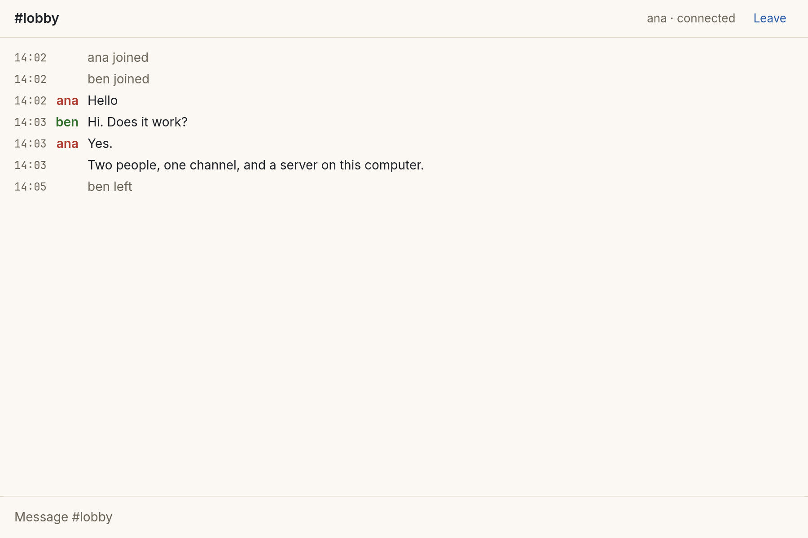

# Post

> Post is a modern chat app in the spirit of IRC: simple, open, self-hosted, with optional end-to-end encryption.

Post is between IRC and Telegram. It keeps the simplicity of IRC, and it adds the functions that most people use each day. The [design philosophy](docs/philosophy.md) gives the ideas behind Post.

The website of the project is [collide2954.github.io/post](https://collide2954.github.io/post/).



## State of the project

Post is at the start of its development. Do not use it for real conversations.

Version 0.1 is the first slice. It shows that all the layers work together:

- Two or more people exchange text in one channel, `#lobby`.
- The server and the applications run on one computer.
- The application has English and Latin American Spanish text.
- The application has light mode and dark mode.

Version 0.1 has no accounts, no encryption, and no stored history. The connection does not go across a network. The [roadmap](docs/decisions/engineering.md) gives the sequence of the next versions (record D-100).

The main branch contains the work on version 0.2. The application now signs in with an account. The connection still has no encryption, and it does not go across a network.

## Try the main branch

You must have [rustup](https://rustup.rs). It installs the Rust release that the file `rust-toolchain.toml` gives.

1. Start the server:

   ```
   cargo run --bin post-server
   ```

   At the first start, the server prints an owner link.

2. In a second terminal, start the application:

   ```
   cargo run --bin post
   ```

3. Paste the owner link into the first field. Type a name, and select **Connect**. You are now the owner of the server.
4. Write a message.

The application keeps a secret seed in a file in your user directory. Only your user account can read the file, and the seed has no other protection at this time (record D-169).

The server listens on port 7678. To use a different port, give the number: `cargo run --bin post-server -- --port 9000`. The server keeps its data in the directory `post-server-data`.

## Documents

| Document | Content |
|---|---|
| [Design philosophy](docs/philosophy.md) | The ideas behind Post |
| [Decision records](docs/decisions/README.md) | Each design decision and its reason |
| [Protocol specification](docs/protocol/README.md) | The messages between a client and a server |
| [Architecture](docs/architecture.md) | The parts of the code |
| [Threat model](docs/threat-model.md) | What Post protects, and what it does not protect |
| [Verification](docs/verification.md) | Which parts of the code have a formal proof, and which parts have none |
| [Changelog](CHANGELOG.md) | The changes in each version |

## Repository layout

| Directory | Content |
|---|---|
| `crates/post-proto` | Message types, codec, and protocol rules |
| `crates/post-server` | The server program, `post-server` |
| `crates/post-client` | The client logic without an interface |
| `crates/post-app` | The application, `post` |
| `docs` | The documents |
| `site` | The pages and the styles of the website |
| `tools` | Scripts for the automatic checks, and the program that makes the website |

## Development

Read [CONTRIBUTING.md](CONTRIBUTING.md) before you change the code. It gives the rules and the commands.

## Security

Do not report a security problem in a public issue. [SECURITY.md](SECURITY.md) tells you how to make a private report.

## License

Post has the [Apache License, version 2.0](LICENSE).

The application contains the fonts Inter and JetBrains Mono. They have the SIL Open Font License, version 1.1. The license texts are in `crates/post-app/fonts`.
